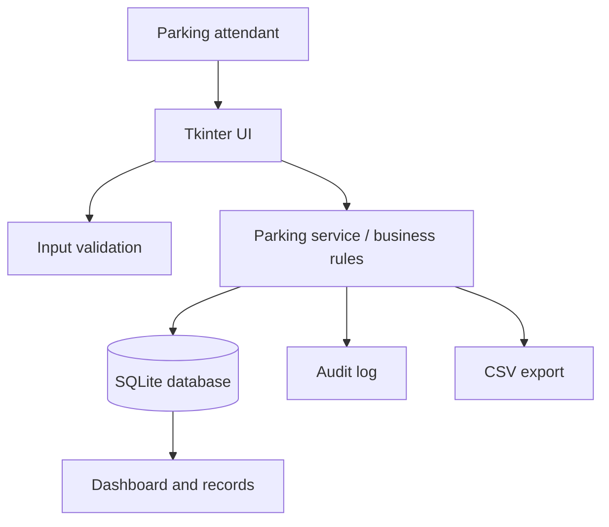
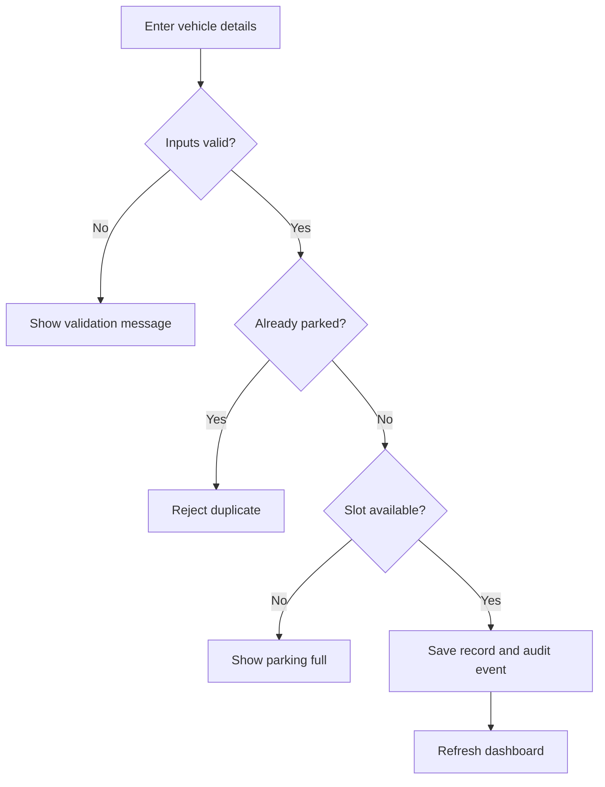

# System Architecture

## Module responsibilities
- `parking_app/ui.py`: forms, dashboard, tables, dialogs and user interactions.
- `parking_app/validators.py`: validation and normalization before data reaches persistence.
- `parking_app/service.py`: slot allocation, duplicate prevention, billing, record search, export and audit events.
- `parking_app/database.py`: SQLite schema, transactions and initialization.
- `parking_app/config.py`: paths and defaults.

## Main vehicle-entry flow

